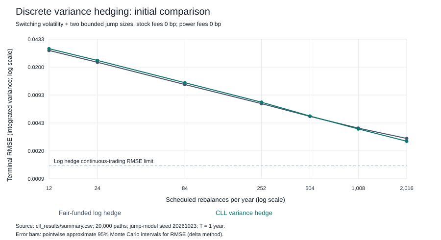
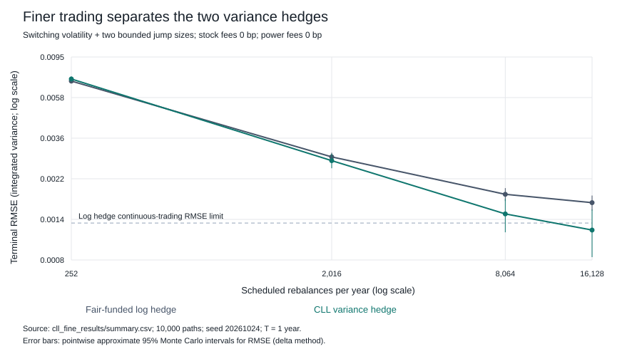
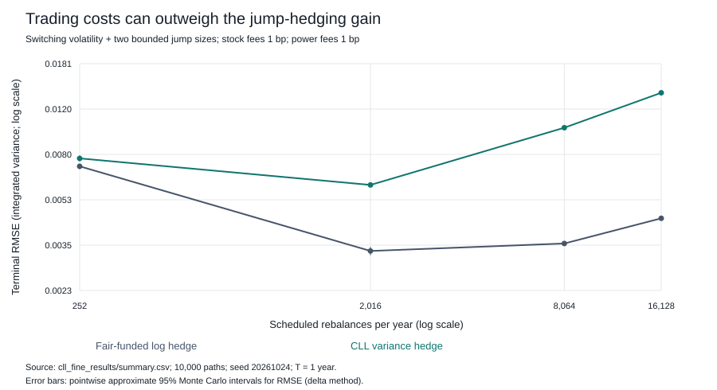

# CLL hedge: implementation and first paired results

October 19, 2026 · synthetic numerical experiments · not a novelty claim

## What is now implemented

The separate `cll_hedge.py` implements the real-power exponential claim from the paper's Section 4 and its analytically differentiated variance hedge. It trades stock, cash, an ideal log/base power claim, and two complementary European power pairs. Holdings are fixed between trading dates. Initial capital is the fair claim price, and the cash account finances every rebalance without resetting wealth to the theoretical price.

The original `simulate.py` is preserved. The new comparison uses identical fair initial capital for the CLL and log-only strategies. Its baseline numbers consequently differ from the original raw payoff residual by a deterministic jump-premium adjustment. See `CLL_METHOD.md` for the derivation, source references, sign discrepancy, and pricing assumptions.

## What the runs show

In the 20,000-path switching-volatility/jump sample, at 252 trades/year, zero-fee RMSE is **0.007594 for CLL**, compared with **0.007293 for the log hedge**. The extra hedge is worse on this trading schedule.

At 2,016 trades/year, zero-fee RMSE is **0.002584 for CLL** and **0.002790 for the log hedge**. The paired mean squared-error difference (CLL minus baseline) is **-1.11e-06**, with a pointwise approximate 95% interval **[-1.38e-06, -8.3e-07]**. Negative favors CLL.

In the separate 10,000-path finer-grid run, at 16,128 trades/year, RMSE is **0.001204 for CLL** and **0.001670 for the baseline**, a **27.9%** reduction. The baseline's analytically known continuous-trading RMSE limit is **0.001310**. We do not claim the observed CLL curve has already reached its limiting regime or prove a convergence rate from these few grids.

The independent 20,000-path repeat gives CLL/baseline RMSEs of **0.007277/0.007081** at 252 trades/year and **0.002617/0.002807** at 2,016 trades/year. Each within-run comparison is paired. The fine-grid run reuses the repeat's jump-market seed with a different grid and batch size, so it is a grid sensitivity run rather than a third independent seed replication.

## Costs change the conclusion

In the finer-grid sample at 16,128 trades/year, applying a stylized one basis point to both stock and ideal power/log claim turnover raises CLL RMSE to **0.013934**, versus **0.004492** for the simpler hedge. These ideal-claim fees are a sensitivity calculation, not the cost of an executable vanilla option strip. A zero-value collar can require substantial gross trading.

## Validation

Fourteen deterministic tests cover jump matching at both allowed sizes, the analytic derivative, power-price symmetry, the paper's pricing representation, conditional moment recursion, frozen-position self-financing, terminal values, causality, and the no-jump limit. Generated output validation:

- cll_results: 203/203 output checks
- cll_second_seed: 203/203 output checks
- cll_fine_results: 39/39 output checks

Normal/delta-method Monte Carlo intervals are approximate and pointwise, with no adjustment for testing multiple grids. Tail quantiles need larger samples and separate uncertainty estimates. The spanning matrix condition number is about 9,080 and is recorded in metadata; numerical identity tests pass despite that sensitivity.

## Next research work

1. Reproduce the derivation in `CLL_METHOD.md` independently and review the documented source sign convention with Professor Lorig before citing these results as a paper reproduction.
2. Replace the ideal European power/log instruments by explicitly funded finite-strike vanilla portfolios. Separate strike truncation, strike spacing, and transaction costs. Keep the ideal version as the control.
3. Test collar-power choices and parameter sensitivity on fresh samples. The finite-frequency crossover is specific to the selected support, powers, volatility process and fees; it is not a universal threshold.
4. Review related literature before claiming novelty, then write a short note around one clearly defined friction and an explanation of its error scaling.

This implements a specific CLL exponential strategy and variance limit under independent volatility and two-point jumps. It does not implement the barrier paper, arbitrary jump distributions, or a market-ready hedge.
