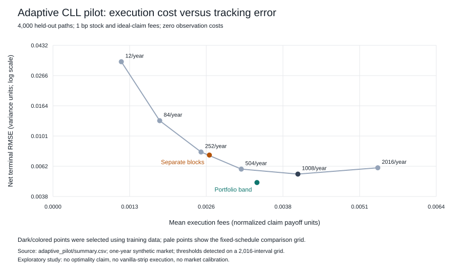

# Verification and adaptive-execution pilot

November 2, 2026. Research preparation and exploratory experiments; no external peer review or publication claim.

## Components prepared

- `review_packet/VERIFICATION_NOTE.md`: equations, source mapping, sign question, continuous-risk argument, worked account and focused human-review questions.
- `reference_ledger.py`: separately expressed market marks, holdings and explicit purchase/sale cash debits; no primary-engine strategy/pricer imports.
- `verification/audit.json`: 144 cross-engine cases, maximum pathwise wealth difference 2.11e-12, with file hashes.
- `test_reference.py`: nine additional tests including causality of execution decisions, actual cost debits and a volatility-state repricing.
- `research/ADAPTIVE_RESEARCH_PLAN.md`: literature, candidate threshold formulas, redundant-collar cost minimization, experiment design and limits on novelty claims.

Both implementations use the same specification. External review of the jump-sign convention and the variance-limit derivation is pending.

## Pilot design

Observe on a grid with 2,016 intervals per year. Compare six deterministic trading frequencies and two types of exposure bands. An exposure band calculates the gross current-value difference between held and prescribed positions, and trades only when that difference exceeds a threshold. Portfolio-level bands update all hedge legs together. Separate-block bands allow stock and European positions to trigger independently.

Use 1,000 training paths to choose one policy in each family, followed by 4,000 fresh holdout paths. Selection minimizes normalized pre-cost squared tracking error plus 0.1 times normalized mean fees. Because this criterion uses pre-cost error, it does not count fees twice. Net RMSE and actual fees are reported separately. The risk/cost weight is an economic choice, not an estimated universal constant.

All policies face the same market paths and initial capital. Fees are one basis point of stock and ideal European/log instrument turnover. Entry costs and stock liquidation are charged; European claims settle without a closing fee. Monitoring is free, execution is immediate at the current synthetic market mark, and borrowing is unconstrained at zero interest. These assumptions limit practical conclusions.

## Held-out result

The training-selected fixed schedule was **1008 intervals/year**, with **1007** intermediate rebalances, net RMSE **0.005495**, and mean fees **0.004081**.

The selected portfolio-band threshold was **0.05** normalized gross-value units. It made about **356.7** intermediate rebalances while checking **2015** times, with net RMSE **0.004799** and mean fees **0.003399**: **12.7% lower RMSE and 16.7% lower mean fees** than the training-selected clock rule.

The paired difference in net squared error (band minus clock) was **-7.17e-06**, with approximate pointwise 95% interval **[-8.56e-06, -5.78e-06]**. This is conditional on the selected pilot design; it is not an estimate of all selection/model uncertainty.

The separate-block band had net RMSE **0.007451** and fees **0.002606**. It saved execution costs but worsened tracking relative to the selected fixed schedule. This supports investigating coordination between hedge legs; it does not yet establish the mechanism.



## Robustness checks and limitations

The same selected policies, without retuning, were tested on three additional 1,000-path scenarios: slower volatility switching, faster switching, and a three-state bounded volatility process. The portfolio band's paired score and net-MSE differences favored it in these pilot scenarios; the separate-block rule performed worse on those measures. These finite examples do not prove model-free robustness. European prices remain consistent with the true scenario law, so this is within-class transfer, not deliberate price-model misspecification.

The selected thresholds are at the smallest edge of the searched threshold grid (.05). A later training/validation stage should expand that range. Do not search the existing holdout for a new preferred threshold and keep treating it as a final test. A larger preregistered study needs fresh final-test seeds, cost-weight sensitivity, finer observation grids, tail-loss uncertainty and comparison at matched cost/error budgets. Savings relative to one selected grid point are not global optimality.

The pilot passed **75/75** saved-output checks. Original tests and nine reference tests also pass. Scripts and pathwise selected-policy outputs make the reported comparisons reproducible.

## Why this is not yet novel/publication-ready

Threshold rebalancing and no-transaction bands are established. A stronger candidate contribution would be a jump-exposure-aware execution rule or cost-aware selection among redundant jump-spanning collars, accompanied by a derivation/bound and held-out evidence for the CLL construction. The focused literature search cannot certify novelty. Review the plan's primary sources and ask a knowledgeable reviewer about overlap before making that claim.

## Reproduce

```powershell
python test_cll.py
python test_reference.py
python run_reference_audit.py
python run_adaptive.py
python validate_adaptive.py adaptive_pilot
python report_adaptive.py
```

Source and audit details: `review_packet/VERIFICATION_NOTE.md`. Research question and publication criteria: `research/ADAPTIVE_RESEARCH_PLAN.md`. No reviewer has been contacted automatically.
